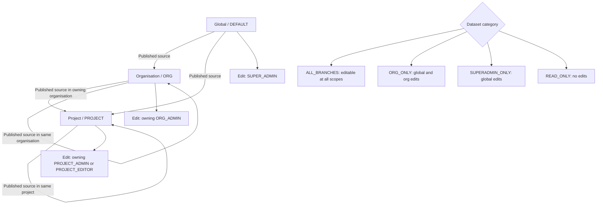

# Dataset authorization, permissions, and governance

## Purpose and status

This document describes the current dataset access policy and implementation. Revision management, the shared dataset read guard, revision-aware lookups, and the reviewed calculation routes enforce signed-in access and scope checks. Grade 2 component and B4 replacement calculations use revision-scoped factors.

## Dataset scope and governance categories

A dataset revision belongs to one scope:

| Scope | Meaning | Owner ID |
| --- | --- | --- |
| `DEFAULT` | Platform-wide/global branch | Normally null |
| `ORG` | One organisation's branch | Organisation UUID |
| `PROJECT` | One project's branch | Project UUID |

Every dataset type is included when branching. The category controls **who may edit its values at each scope**, not whether the type exists in a child branch.

| Category | Global / `DEFAULT` | Organisation / `ORG` | Project / `PROJECT` |
| --- | --- | --- | --- |
| `ALL_BRANCHES` | `SUPER_ADMIN` | Owning `ORG_ADMIN` | Owning `PROJECT_ADMIN` or `PROJECT_EDITOR` |
| `ORG_ONLY` | `SUPER_ADMIN` | Owning `ORG_ADMIN` | No project edits; values remain visible/read-only |
| `SUPERADMIN_ONLY` | `SUPER_ADMIN` | No org edits; values remain visible/read-only | No project edits; values remain visible/read-only |
| `READ_ONLY` | No edits | No edits | No edits |

### Governance diagram

Each revision belongs to exactly one scope. The dataset category and the role
for that scope jointly determine whether its values can be edited. Branching
copies all dataset types; categories only control edits in the destination.

The branch arrows show the allowed source relationships. Current branch creation
also requires a published source and enforces destination ownership and source
scope; details are below.

### Dataset types mapped to categories

The category map in `backend/core/dataset_permissions.py` uses backend dataset keys; the frontend may show friendlier tab labels.

**`ALL_BRANCHES`:** `background_grade_metrics`, `grade_1_asset_level`, `grade_2_component_level`, `grade_3_4_detailed_level`, `default_transport_distances`, `transport`, `recycled_content`, `recycled_content_factors`, `material_recycled_content`, `default_waste_rates`, `waste_rates`, `vehicle_masses`, `vepm_tables`, `vepm_factors`, `emissions_factor_sets`, `fugitives`.

**`ORG_ONLY`:** `maintenance_replacement`, `maintenance_replacement_factors`, `wastage_rates`, `default_wastage_rate`, `bau_assumptions`, `concrete_mix_assumptions`, `carbon_values`, `operational_equipment`, `freight_rail`, `freight_rail_factors`, `ev_uptake`, `ev_uptake_factors`, `vehicle_energy`, `vehicle_energy_conversion_rates`, `direct_substitutions`, `electricity_recycling_assumptions`, `concrete_mix_designs`.

**`SUPERADMIN_ONLY`:** `densities`, `electric_decarb_factors`, `electricity_decarbonisation`, `unit_conversions`, `energy_density_conversions`, `renewable_energy_classification`, `renewable_energy`, `interrupted_vehicles`, `user_enabled_carbon_stop_start`, `uninterrupted_vehicles`, `user_enabled_carbon_uninterrupted`.

**`READ_ONLY`:** `audit_trail`, `audit_logs`.

Unregistered keys currently default to `SUPERADMIN_ONLY` in `get_dataset_category`, and revision writes reject unregistered dataset types. New dataset keys should still be explicitly registered so their intended governance category is clear.

## Current access policy

“Everyone can view datasets” means users can view published global datasets. Organisation and project data are visible only within the user's own scope hierarchy. Drafts are visible only to editors who manage the draft's owning scope.

| User | View access | Edit and revision management |
| --- | --- | --- |
| `SUPER_ADMIN` | Published global datasets and platform management views | Create, edit, branch, and manage `DEFAULT` revisions. A published global revision cannot be unpublished; create a new revision to change global data. |
| `ORG_ADMIN` | Published global revisions and revisions belonging to their organisation; no other organisations' or projects' revisions | Create and manage revisions belonging to their organisation; edit values there only for `ALL_BRANCHES` and `ORG_ONLY`. May unpublish a published org revision after confirming its current project bindings. Global revisions are view-only. |
| `PROJECT_ADMIN` / `PROJECT_EDITOR` | Published global and owning-organisation revisions, plus their project revisions; no unrelated orgs/projects | Create and manage their project's revisions; edit values there only for `ALL_BRANCHES`. May unpublish a published project revision after confirming its current project binding. Global and org revisions are view-only. |
| Read-only users, including `PROJECT_VIEWER` | Published revisions in scopes they belong to, plus published global revisions | No dataset record edits or revision lifecycle operations. No drafts. |

### Branch creation rules

- An organisation admin may create an org branch from a published global revision or a published revision of that same organisation.
- A project admin/editor may create a project branch from a published global revision, a published revision of the owning organisation, or a published revision of that same project.
- Branching copies the complete dataset set. Dataset categories determine which copied values the child-scope editor may change.
- Branches must not be made from another organisation's or another project's revision.

## Revision lifecycle and governance

The model defines `draft`, `published`, `deprecated`, and `archived` statuses. Lifecycle operations belong to the owning scope's editors: super admins for global, the owning org admin for org, and project admins/editors for project.

| Status | Meaning | Dataset values editable? | Visibility under target |
| --- | --- | --- | --- |
| `draft` | Work in progress; not available for new project bindings | Yes, subject to category and scope rights | Only editors of its owning scope |
| `published` | Active revision available for use | No; org/project editors may unpublish after reviewing current bindings; global revisions require a new revision | Visible to users permitted to view its scope |
| `deprecated` | Superseded by a newer revision; cannot have current project bindings | No | Viewable where scope access permits, especially for history |
| `archived` | Retired; no new bindings or edits | No | Retained for audit/history, subject to scope read access |

```mermaid
stateDiagram-v2
    [*] --> draft: Create or branch
    draft --> published: Publish / factor set required; recalculate current bound projects
    published --> draft: Unpublish / ORG or PROJECT after confirming current bindings
    published --> deprecated: Deprecate / no bound projects
    draft --> archived: Archive / no bound projects
    published --> archived: Archive / no bound projects
    deprecated --> archived: Archive / no bound projects
    archived --> [*]
```

Only `draft` permits record edits. The `archived --> [*]` notation represents
the terminal state: archived revisions have no outgoing transitions. Deletion
is a separate operation and is blocked by project bindings or attached factor
sets.

Current lifecycle behavior:

- Only a `draft` can be published; publication requires at least one emissions factor set.
- A published `DEFAULT` revision cannot be unpublished; create a new revision to change global data.
- A published `ORG` or `PROJECT` revision can be unpublished after a scope editor reviews and confirms the exact current project binding list. The bindings remain while the revision is in draft; projects cannot newly bind to it in that state.
- When a bound org/project revision is published again, each currently bound project is recalculated using that revision. Successful projects are committed independently. A project whose calculation fails keeps its previous saved results; publication completes and returns per-project failures and missing-data warnings.
- A published revision can be deprecated only when no projects are currently bound to it. The UI displays the current binding list and blocks confirmation when any project is listed; the backend rechecks bindings during the action.
- A `draft`, `published`, or `deprecated` revision can be archived, but archiving is blocked while projects are bound. `archived` has no outgoing lifecycle transition.
- A revision cannot be deleted while projects are bound or while emissions factor sets belong to it.
- Record-write authorization rejects every non-draft status. The frontend also locks edits when the selected revision is not a draft.

## Current enforcement and data flow

The current implementation enforces these access and lifecycle controls:

- `backend/core/dataset_permissions.py` defines the four categories, the dataset type map, scope restrictions, and a fail-closed default for unregistered keys.
- Revision list and detail routes require an authenticated principal. Listing filters revisions by visibility before applying caller filters and pagination; direct-ID reads apply the same visibility check. Non-draft revisions (`published`, `deprecated`, and `archived`) are visible according to the caller's scope hierarchy, while drafts are limited to editors of their owning scope.
- Branch creation requires a published source, checks that the destination belongs to the caller, and restricts sources to global, same-organisation, owning-organisation, or same-project branches as appropriate.
- Revision record writes require a draft, enforce category-to-scope rules, and check the owning-scope role. The record-write helper does not grant a general super-admin exception for organisation or project revisions. Revision management routes also check scope roles; organisation archive is restricted to the owning organisation admin. Unpublish and deprecate lifecycle actions check current project bindings on the backend.
- Shared dataset-read authorization is attached to revisioned dataset routers. It authenticates requests, resolves explicit revision selectors or row ownership, and checks revision visibility. Revision-aware BGM, typecast, emission-source, electricity-unit, and mastertype/typecast availability lookups apply the authorized revision to their data queries. Operational equipment and maintenance-factor reads resolve an explicit revision or the project's binding; requests with neither are rejected.
- Reviewed calculation routes for Grade 1, Grade 2 component and B4 replacement, Grade 3/4 detailed construction, detailed operational electricity, concrete-register calculations, and annual road-emission calculations require authentication and authorize the revision or project binding they use. Grade 2 factors are pivoted from `background_grade_metrics` within the selected revision instead of read from `v_grade2_component_level`. The Grade 2 endpoint accepts a project ID or explicit revision ID, rejects requests with neither, and rejects an explicit revision that differs from the project binding. B4 requires a project and uses its bound revision. Grade 1 and Grade 3/4 calculations without project context require an explicit revision selector.
- Project-scoped mastertype and typecast lists check project access and filter availability through that project's bound revision. Their detail endpoints return stable reference records and require a signed-in user. The older `/api/lookup/emission-sources` and `/api/lookup/emission-factors` endpoints use global reference tables without revision ownership; they are not branch dataset endpoints.
- The dataset UI loads own-scope revisions and published inherited revisions. Project-scope edit controls now load effective roles from `/api/me/access?project_id=...`; backend authorization remains authoritative. Other controls are presentation hints and do not replace scoped backend checks.

## Verification status

The backend authorization and revision checks have been run and passed, including the regression check that revision-aware lookup routes use the shared read authorization. The Grade 2 and B4 authorization coverage, Python syntax checks, and frontend production build have also been reported as passing. No authorization implementation or verification work from the current checklist remains open.

## Ongoing maintenance

Keep the route inventory current as dataset lookups and calculations are added. For every new revision-aware route, verify explicit revision selectors, project-binding resolution, missing-selector rejection, direct-ID access, and denial for unrelated scopes. The global emission-source and emission-factor endpoints remain static reference data, not revision-scoped dataset records.

## Source files reviewed

- `backend/core/dataset_permissions.py`, `backend/core/dataset_authorization.py`
- `backend/models/dataset_revisions.py`, `backend/schemas/dataset_revisions.py`, `backend/crud/dataset_revisions.py`, `backend/routers/dataset_revisions.py`
- `client/src/pages/datasets/DatasetsPage.tsx`, `OrgDatasetsPage.tsx`, `ProjectDatasetsPage.tsx`, `ProjectDatasetsSelectPage.tsx`
