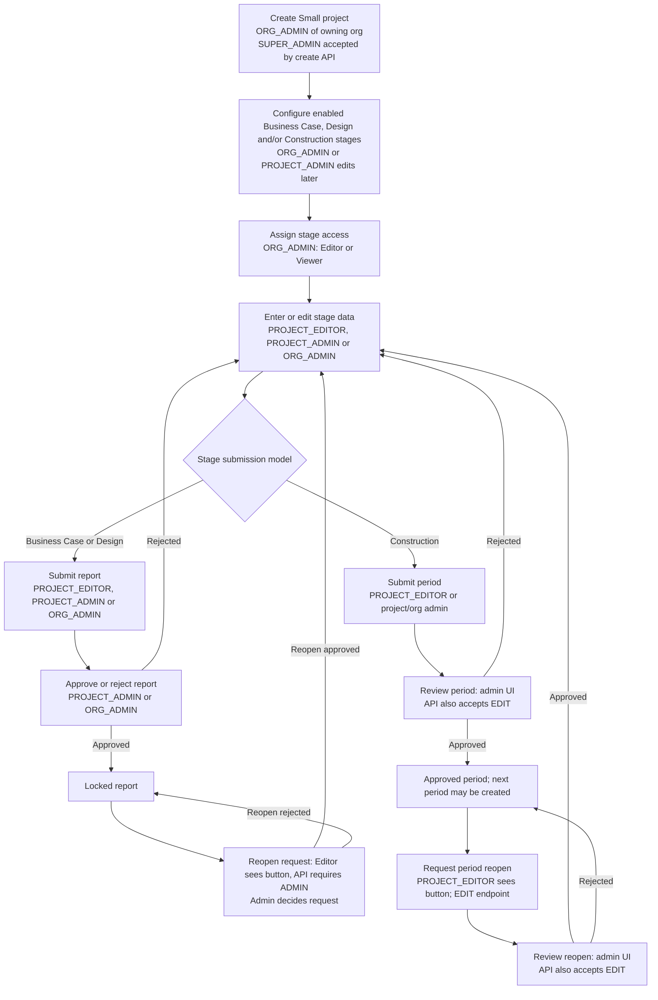
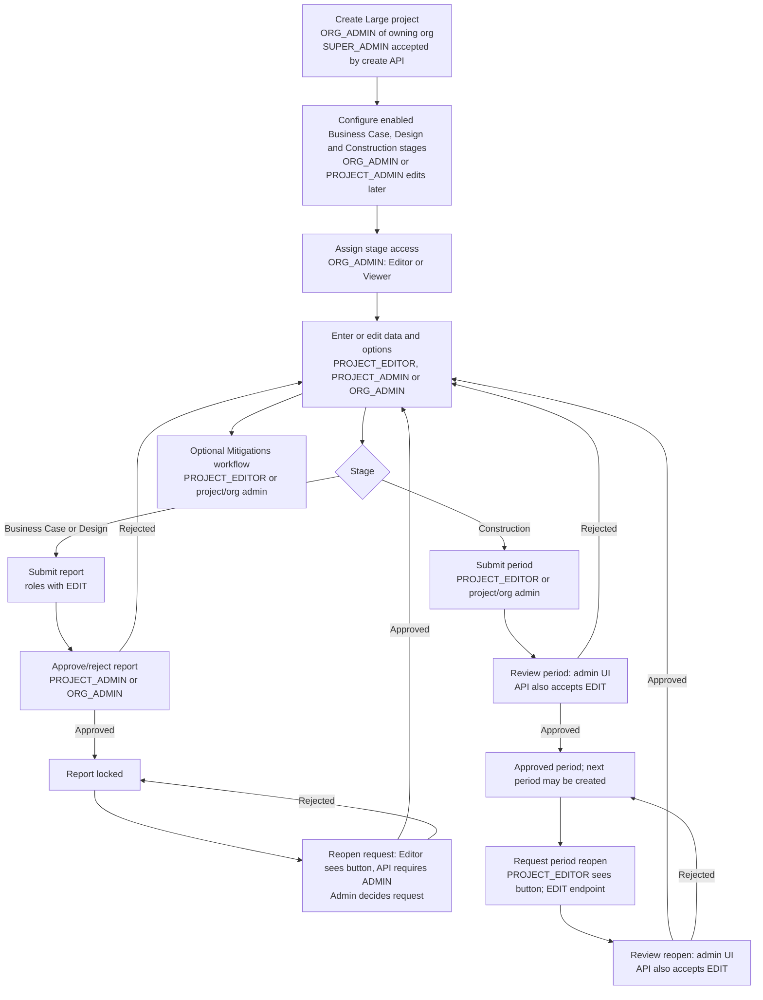
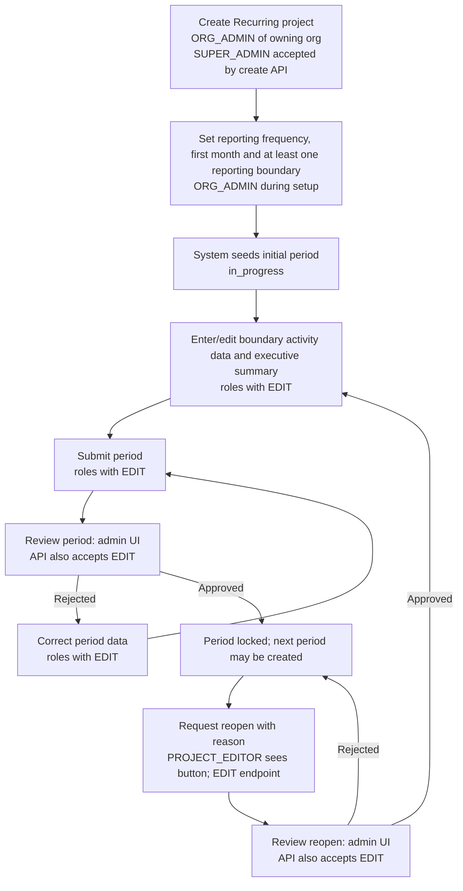
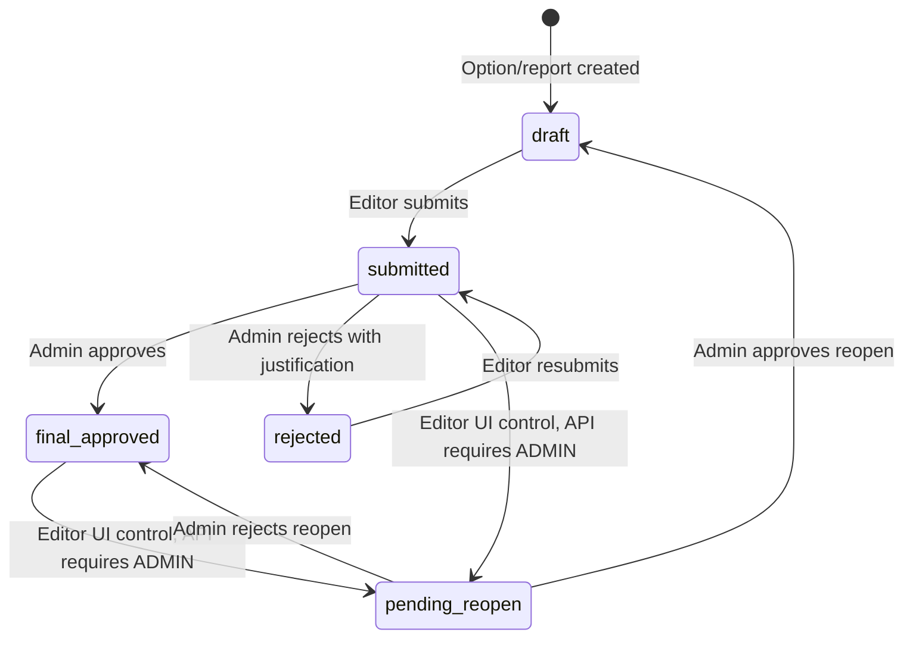
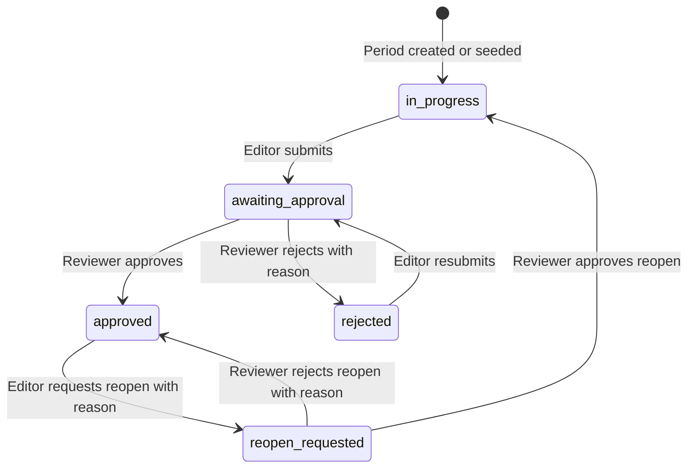

# Project workflow and permissions

## Purpose and status

This document describes the current project lifecycle, data-entry and submission workflows, and the permissions enforced by the application. It covers project creation and updates, access assignment, data entry, approval, reopening, and resubmission.

Project stages use two different submission models:

- **Business Case and Design** use project options/reports, identified by a stage instance and report number.
- **Construction and Recurring** use dated reporting periods, identified by a period ID and label.

The two models have related goals but different statuses and, in a few places, different permission checks. Those differences are called out below as current implementation behavior.

## Roles and effective project access

Project access is resolved for the specific project and enabled stage. Active `ORG_ADMIN` assignments for the project's owning organisation and active `PROJECT_ADMIN` assignments for the project grant `ADMIN` access to all enabled stages. `PROJECT_EDITOR` and `PROJECT_VIEWER` grant `EDIT` and `VIEW` only when assigned to a particular stage instance.

| Role | Scope | Effective access | Main responsibilities |
| --- | --- | --- | --- |
| `SUPER_ADMIN` | `GLOBAL` | No project or stage access by itself | Platform administration. It may create a project for an organisation when the create-project check sees the global role, and it can review pending items in the Home indicators. It must still receive project/stage access to use protected project workflows. |
| `ORG_ADMIN` | Owning `ORGANISATION` | `ADMIN` on every enabled stage and the project | Create projects for that organisation; modify project setup; manage stage assignments; manage ordinary project-user access; administer project options and reports. |
| `PROJECT_ADMIN` | `PROJECT` | `ADMIN` on every enabled stage and the project | Modify project setup; manage ordinary project-user access; administer project options and reports. Cannot manage stage assignments through the project setup endpoint or grant another user the `PROJECT_ADMIN` role. |
| `PROJECT_EDITOR` | One `STAGE` | `EDIT` on that stage | View and edit stage data, create/update/delete entries allowed by the stage workflow, and submit eligible reports or periods. |
| `PROJECT_VIEWER` | One `STAGE` | `VIEW` on that stage | Read stage data and reports. Cannot edit or submit. |
| `GENERAL_USER` / no project role | `GLOBAL` or none | No project access until explicitly granted | May request access, but registration alone does not grant project access. |

`ORG_ADMIN` and `PROJECT_ADMIN` access is limited to the project and enabled stages in their role scope. A `SUPER_ADMIN` is not automatically a project member. A disabled or unrelated stage does not grant access, even if an old stage instance remains for historical records.

## Project creation and setup

1. An organisation administrator creates the project under the owning organisation. The create endpoint accepts an `ORG_ADMIN` for that organisation; it also accepts `SUPER_ADMIN` through the global-role check.
2. Setup supplies project class/type, project details, enabled stage configurations, reporting frequency/report counts where applicable, locations and other project metadata. Recurring projects also specify a first submission month and at least one reporting boundary.
3. The project service creates stage configuration and stage-instance records. A recurring project receives its initial reporting period during creation. Construction periods can be generated through the optional period-generation path or added through the period API by someone with stage edit access.
4. The creator or an authorised administrator assigns access. The project then appears to users with an effective project or stage role.

## Project-class workflows and Data Entry contents

The class determines which stages and substages appear. Stage availability also depends on the project's enabled stage configuration and the user's access to that stage. The data-entry lists below describe the current UI; a project may show fewer stages when they are disabled, and some tables appear only for applicable project types or configured data.

### Small project workflow

Small project Data Entry is organized as follows:

| Stage | Substage / section | Tables or panels shown |
| --- | --- | --- |
| Business Case | Construction | Asset level; Component level |
| Business Case | Replacement (B4) and Refurbishment (B5) | Component level replacement; Other partial replacement or refurbishment activities |
| Business Case | Operational energy (B6) | Component level (Grade 2) |
| Business Case | Users (B8) | Road users; Rail users when the project type is Rail |
| Design | Construction | Component level |
| Design | Replacement (B4) and Refurbishment (B5) | Component level replacement; Other partial replacement or refurbishment activities |
| Design | Operational energy (B6) | Component level (Grade 2) |
| Construction, when enabled | Construction reporting period | Component level (Grade 2); Detailed level - construction stage (Grade 3); Electricity |

The **Completeness** tab may also appear for Small Business Case, Design, and Construction stages when configured. Small projects do not show the Large-project Use (B1), detailed replacement/operational tables, Large-project concrete register, or Mitigations tab.

### Large project workflow

Large project Data Entry has these stage sections:

| Stage | Substage / section | Tables or panels shown |
| --- | --- | --- |
| Business Case | Construction | Asset level; Component level; Detailed level (Grade 3); Electricity |
| Business Case | Use (B1) | Component Level (Grade 2); Detailed Level (Grade 3) |
| Business Case | Replacement and Refurbishment (B2-B5) | Component level replacement; Other partial replacement or refurbishment activities; Detailed Level (Grade 3) |
| Business Case | Operational energy (B6) | Component level (Grade 2); Detailed Level (Grade 3); Electricity |
| Business Case | Users (B8) | Road users by modelled year; Rail users when applicable to project type |
| Design | Construction | Component level; Detailed level (Grade 3); Electricity; Concrete register (Grade 3/4) - simplified and detailed |
| Design | Use (B1) | Component Level (Grade 2); Detailed Level (Grade 3) |
| Design | Replacement and Refurbishment (B2-B5) | Component level replacement; Other partial replacement or refurbishment activities; Detailed Level (Grade 3) |
| Design | Operational energy (B6) | Component level (Grade 2); Detailed Level (Grade 3); Electricity |
| Design | Users (B8) | Road users by modelled year; Rail users when applicable to project type |
| Construction | Construction | Component level; Detailed level - construction stage (Grade 3); Electricity; Concrete register (Grade 3/4) - simplified and detailed |
| Construction | Use (B1) | Component Level (Grade 2); Detailed Level (Grade 3) |
| Construction | Maintenance, Repair, Replacement and Refurbishment (B2-B5) | Component level replacement; Other partial replacement or refurbishment activities; Detailed Level (Grade 3) |
| Construction | Operational energy (B6) and Water (B7) | Component Level (Grade 2); Detailed Level (Grade 3); Electricity |

Large projects may also show **Completeness** in Business Case, Design, and Construction. **Mitigations** is available only in Design and Construction; its tables are mitigation-specific copies/legs of applicable data-entry tables, including replacement, Use B1, operational energy, electricity and user data where configured. Construction and Recurring-stage tables are period-scoped; Business Case and Design tables are report/option-scoped.

### Recurring project workflow

Recurring projects use a single Recurring stage and monthly or otherwise configured reporting periods. The first period is seeded from the configured first submission month; subsequent periods are created through the period workflow.

Recurring Data Entry has **no substage selector**. For the selected reporting month, it shows:

| Stage | Data-entry tables / panels |
| --- | --- |
| Recurring | One Grade 3/4 emissions table for each configured reporting boundary activity, titled from the activity (for example, Construction or Operations); period emissions summary; Executive summary |

The available activity tables are generated from the project's reporting boundaries. If no recurring tables appear, the project needs at least one configured reporting boundary. Period row edits and the executive summary are saved against the selected period.

### Data Entry permission summary by role

| Data Entry activity | `PROJECT_VIEWER` | `PROJECT_EDITOR` | `PROJECT_ADMIN` | Owning `ORG_ADMIN` | `SUPER_ADMIN` without project assignment |
| --- | --- | --- | --- | --- | --- |
| View an enabled stage and its tables | Yes, assigned stages only | Yes, assigned stages only | Yes, all enabled stages | Yes, all enabled stages | No |
| Edit rows, options, or period summaries | No | Yes, assigned stages only | Yes | Yes | No |
| Submit Business Case/Design report | No | Yes, assigned stages only | Yes | Yes | No |
| Approve/reject Business Case/Design report | No | No | Yes | Yes | No |
| Request/review Business Case/Design report reopen | No | Request button is visible, but API rejects `EDIT`; API requires `ADMIN` | API permits Admin, but standard Data Entry request button is hidden for admins; admin review is available | API permits Admin, but standard Data Entry request button is hidden for admins; admin review is available | No |
| Submit Construction/Recurring period | No | Yes, assigned stages only | Yes | Yes | No |
| Approve/reject or decide period reopen | No in current UI; backend accepts `EDIT` | Buttons are hidden, but backend accepts `EDIT` | Yes in UI and API | Yes in UI and API | No |

Current UI/API differences: Business Case/Design shows the reopen-request button to Editors, but its endpoint requires `ADMIN`; admins can pass the endpoint check, but the standard Data Entry request button is hidden for them. For Construction/Recurring, period decision endpoints accept `EDIT`, while the UI exposes approval/rejection controls only to project/organisation admins. The period reopen-request button is exposed to Editors, matching that endpoint's `EDIT` check, but hidden for admins even though the API would allow them. Home pending-action cards are scoped to Super Admins, Organisation Admins, and Project Admins. See the detailed period-workflow note below.

### Creating and modifying setup

| Action | Required access | Current behavior |
| --- | --- | --- |
| Create project | `ORG_ADMIN` for owning organisation; `SUPER_ADMIN` is also accepted by the create check | Creates project and configured stage instances; recurring setup seeds its first period. |
| Read project details | `VIEW` on the project, inherited from any enabled stage assignment or admin role | Project access is checked before details are returned. |
| Edit project details, stage configuration, close/reopen, or delete | Project-level `ADMIN` (`ORG_ADMIN` or `PROJECT_ADMIN`) | Project Admin can edit project configuration even though they cannot manage stage assignments through the project setup endpoint. |
| Add/remove or change stage assignments in setup | `ORG_ADMIN` for the owning organisation | Project setup rejects `member_accesses` changes from a Project Admin. |
| Search users / manage ordinary project-user stage access | `ORG_ADMIN` or `PROJECT_ADMIN` for the project | Searches active registered users across organisations. Project Admin cannot grant or modify a `PROJECT_ADMIN` assignment; that is controlled by an Organisation Admin. |

Stage access managers assign `PROJECT_EDITOR` or `PROJECT_VIEWER` to individual stage instances. Project Admin and Organisation Admin roles are broader project-management roles, not stage assignments.

### Enabling a stage later

An Organisation Admin or Project Admin can update project stage configuration. Enabling Construction requires its reporting frequency. When a stage is enabled, its stage instance becomes available for access checks and data entry. The application keeps stage instances in sync with configuration; disabled stages do not authorize access. Review stage history and existing records before disabling or changing a stage configuration so historical submissions are not unintentionally disrupted.

Design-only setup may omit a Construction schedule when Construction is not yet known. Construction can be configured later by an authorised project administrator.

## Data entry and editing

Every data-entry read and mutation is checked against the effective access to the specific project stage. `VIEW` permits reads. `EDIT` permits edits, row mutations, and eligible workflow operations. `ADMIN` satisfies both levels.

For Construction and Recurring, data is associated with a selected reporting period. The period must be in an editable state; submitted, approved, and reopen-requested periods are locked. A rejected period can be edited and resubmitted. Business Case and Design entries are associated with their project-option/report context and are locked when their report is approved or otherwise locked by its workflow state.

The backend remains authoritative even when the UI hides or disables controls. A user with no access, a disabled stage, or insufficient access receives a forbidden response from protected endpoints.

## Business Case and Design report workflow

These stages use `project_options` records. A report can have multiple project options, but its approval state is shared for the stage instance and report number.

| Step | Required access | Rules and result |
| --- | --- | --- |
| Ensure/create, rename, set default, copy, or delete options | `EDIT` | Creates or changes report options/data. Existing service validation still applies (for example, options cannot be deleted when prohibited by report state). |
| Enter or edit report data | `EDIT` | Entries are saved under the correct stage, report, and option. |
| Submit report | `EDIT` | Allowed only from `draft` or `rejected`; status becomes `submitted`. The submission is recorded in the stage audit events. |
| Approve report | `ADMIN` | Allowed only from `submitted`; status becomes `final_approved` and the report becomes read-only. |
| Reject report | `ADMIN` | Allowed only from `submitted`; a non-empty justification is required; status becomes `rejected` so the editor can correct and resubmit. |
| Request report reopen | `ADMIN` in the current API | Allowed from `final_approved` or `submitted`; status becomes `pending_reopen`. This endpoint currently requires Admin access, rather than Editor access. |
| Approve reopen request | `ADMIN` | Allowed only from `pending_reopen`; status returns to `draft` so the report can be edited and resubmitted. |
| Reject reopen request | `ADMIN` | Allowed only from `pending_reopen`; status returns to `final_approved`, keeping the report locked. |

## Construction and Recurring period workflow

Construction and Recurring use `project_reporting_submission` periods. A period carries its own label, dates, status, summary, submitter and decision metadata. Approving a period may automatically create the next period according to the project's frequency.

Approving a period may create a **new period record**; it does not move the approved period itself back to `in_progress`.

| Step | Required access in current API | Rules and result |
| --- | --- | --- |
| Read periods | `VIEW` | Lists periods for the accessible Construction or Recurring stage, including period emissions summaries. |
| Create a period | `EDIT` | Creates a period for the supplied project and stage instance. Recurring's initial period is normally seeded at project creation. |
| Enter/edit period data or executive summary | `EDIT` and period must be editable | Period rows and summary are tied to the period ID. Submitted, approved, and reopen-requested periods are locked. |
| Submit period | `EDIT` | Allowed from `in_progress` or `rejected`; status becomes `awaiting_approval`. |
| Approve period | `EDIT` in the current API | Allowed only from `awaiting_approval`; status becomes `approved`; the endpoint attempts to create the next period. |
| Reject period | `EDIT` in the current API | Allowed only from `awaiting_approval`; rejection reason is required; status becomes `rejected` and the editor may correct and resubmit. |
| Request period reopen | `EDIT` | Allowed only from `approved`; a reason is required; status becomes `reopen_requested`. The period remains locked. |
| Approve reopen | `EDIT` in the current API | Allowed only from `reopen_requested`; status becomes `in_progress` and the period can be edited. |
| Reject reopen | `EDIT` in the current API | Allowed only from `reopen_requested`; a reason is required; status returns to `approved` and remains locked. |

**Permission distinction to be aware of:** unlike Business Case/Design report review, the Construction/Recurring approve, reject, and reopen-decision endpoints currently require only `EDIT`. Therefore a stage-assigned Project Editor can satisfy the backend check for those period decisions. Home's pending-action cards are scoped to Super Admins, Organisation Admins, and Project Admins, so period decision capability and Home visibility are not fully aligned. This document records current enforcement; it does not imply that a broader reviewer permission is necessarily the intended policy.

## Home approvals and navigation

The Home page pending-action indicators combine:

- Business Case/Design project-option states `submitted` and `pending_reopen`.
- Construction/Recurring period states `awaiting_approval` and `reopen_requested`.

Pending items are scoped to Super Admins, Organisation Admins for their organisation, and Project Admins for their administered projects. Period links include the period ID so Data Entry opens the matching month. The Home indicator scope is distinct from the period API's `EDIT` check described above.

## Rejection, reopen, and resubmission principles

- Rejection returns a submission to an editable state (`rejected`) and requires correction before it can be submitted again.
- A reopen request does not itself unlock data. The item remains locked until a reviewer approves the request.
- Approving a reopen restores an editable state (`draft` for project-option reports; `in_progress` for periods).
- Rejecting a reopen preserves the approved/locked state (`final_approved` for project-option reports; `approved` for periods).
- A resubmission follows the same review path as the original submission and records a new transition.
- The APIs reject transitions from unexpected statuses with a client error; the UI should refresh status after a successful decision.

## Status transition overview

| Workflow | Status sequence |
| --- | --- |
| Business Case / Design | `draft` → `submitted` → `final_approved` or `rejected`; rejected → submitted; optional `pending_reopen` → `draft` or `final_approved` |
| Construction / Recurring | `in_progress` → `awaiting_approval` → `approved` or `rejected`; rejected → awaiting_approval; optional `reopen_requested` → `in_progress` or `approved` |

## Enforcement and source files

The backend permission and state checks are implemented in these areas:

- `backend/core/authorization_policy.py` and `backend/core/rbac.py` — access levels, role scopes, and project/stage access resolution.
- `backend/routers/project.py` and `backend/crud/project.py` — project creation, editing, stage setup, and project lifecycle.
- `backend/routers/project_access.py` — project user search and stage-access assignment management.
- `backend/routers/project_options.py` — Business Case/Design options and report status transitions.
- `backend/routers/construction_periods.py` — Construction/Recurring periods and status transitions.
- `backend/routers/activity_data.py` — stage/period edit checks and period locking for activity rows.
- `backend/routers/me.py` and `client/src/pages/home/projects/ProjectsPage.tsx` — admin pending-action lists and navigation.
- `client/src/pages/addNewProject/AddNewProject.tsx` and `client/src/pages/smallProject/dataEntry/` — project setup and data-entry workflow UI.

Role assignments and stage configuration are checked by the backend on each protected operation. UI affordances are not the authorization boundary. When endpoint checks or UI indicators differ, use the endpoint rules above as the current backend enforcement and review the mismatch as a policy decision.
