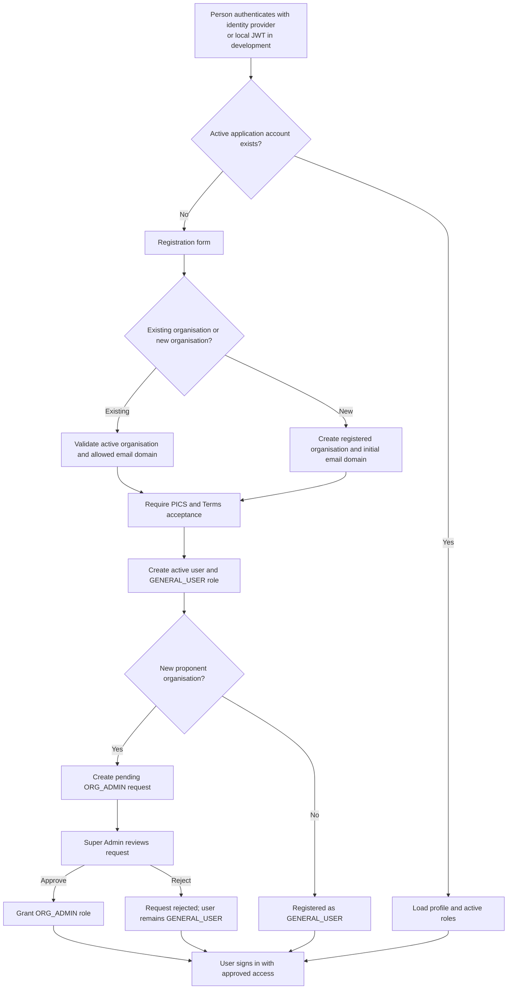
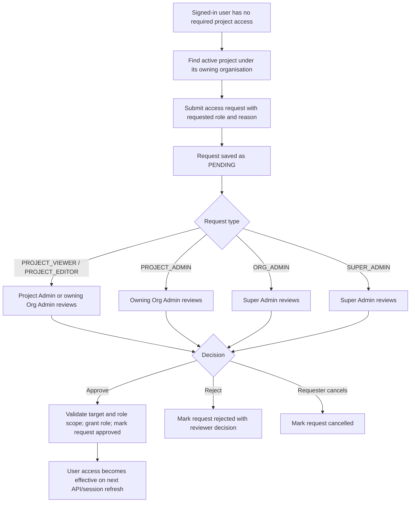
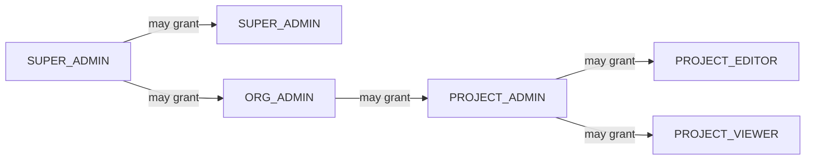
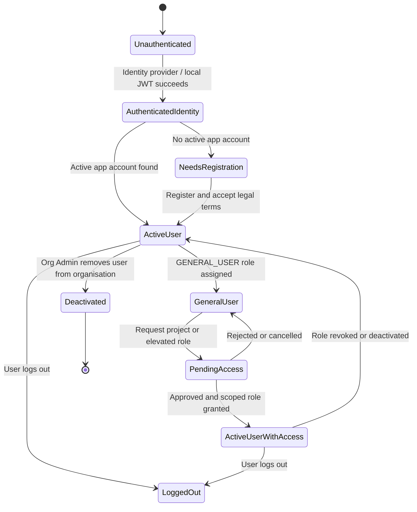

# User registration, access, and account lifecycle

## Purpose and status

This document describes the current application flow from identity authentication and registration through organisation membership, access requests, role assignment, access revocation, and account deactivation/deletion. It is based on the current backend routes and client screens. It records what the application currently does, including differences between UI pathways and backend endpoints; it is not a proposed policy specification.

The application separates three concepts:

1. **Authentication identity** — the identity provider proves who is signing in.
2. **Application account and organisation membership** — a `users` row, an organisation link, and usually a `GENERAL_USER` role.
3. **Authorization** — active `user_roles` assignments at global, organisation, project, or stage scope. Registration alone does not grant access to a project.

There is no server invitation lifecycle in the current implementation. The project-setup “Send an invite” UI is commented out, and its remaining modal handler only updates local state; no invitation email or invitation record is created.

## Identity and role model

Authentication is provided by Azure Easy Auth in deployed mode and local JWT in local development. The backend resolves the authenticated identity to an active `users` row. Requests from an identity with no active application account are directed to registration; requests from a deactivated account are rejected by principal resolution.

| Role | Scope | Current effect |
| --- | --- | --- |
| `SUPER_ADMIN` | `GLOBAL` | Platform-wide administration. It does not, by itself, grant project or stage access. |
| `ORG_ADMIN` | `ORGANISATION` | Administration for that organisation and its projects, including organisation-user and project-administration tasks. |
| `PROJECT_ADMIN` | `PROJECT` | Administration of one project, including managing ordinary project-user stage access. It does not grant access to other projects. |
| `PROJECT_EDITOR` | `STAGE` | Edit access to the assigned stage instance. |
| `PROJECT_VIEWER` | `STAGE` | Read access to the assigned stage instance. |
| `GENERAL_USER` | Usually `ORGANISATION` | Registered organisation membership. It does not grant project access. |

Project and stage effective access is resolved from active role assignments. Organisation and project administrators receive administrative access to applicable enabled project stages. Editors and viewers need stage-scoped assignments. A Super Admin needs a separate project/stage assignment to use protected project workflows.

## Registration and first sign-in

In deployed mode, the identity provider authenticates the person before the application registration form is available. `/api/identity/registration-context` checks whether the forwarded identity already maps to an application account. Existing accounts proceed into the app; identities without an account are shown registration.

The registration form allows a user either to select an existing registered organisation or submit details for a new organisation. The server derives the deployed email from the trusted forwarded identity, requires acceptance of the current Personal Information Collection Statement and Terms of Use, rejects an existing email, and checks that an existing organisation is active and permits the email domain.

| Registration choice | Current result |
| --- | --- |
| Join an existing organisation | Creates an active user linked to that organisation and records the accepted terms versions/timestamps. The account receives an active `GENERAL_USER` role scoped to the organisation. |
| Create a new non-proponent organisation | Creates the organisation, registers its email domain, creates the user, and grants `GENERAL_USER`. |
| Create a new proponent organisation | Creates the organisation and its initial email domain, creates the user and `GENERAL_USER`, and creates a pending `ORG_ADMIN` access request for Super Admin review. The requester is not automatically made an Org Admin. |

Registration records an audit event. Organisation creation and the user/role/request setup are committed together. In local development, the registration payload may include an email; deployed mode uses the authenticated forwarded identity instead.

### Organisation directory and email domains

Registration searches the registered organisation directory. Delivery partners are stored separately and are not a substitute for registered organisations or a source of user access. In deployed mode, allowed email domains are administered by Super Admins. A user choosing an existing organisation must use an email matching one of its active allowed domains. Creating an organisation seeds its initial domain from the registering email address.

The registration error mentions requesting an invitation when the email domain does not match, but the app currently has no invitation workflow that bypasses or updates this domain check. A Super Admin can manage organisation domains through the organisation-domain routes.

## Requesting access

Registration does not automatically place the user on any project. A signed-in user can request access to a project after discovering it by active project name within the selected organisation. Project discovery returns only limited project identity details; it does not grant access.

The current access-request API supports request types including `PROJECT_VIEWER`, `PROJECT_EDITOR`, `PROJECT_ADMIN`, `ORG_ADMIN`, and `SUPER_ADMIN`, subject to the request screen and approval rules. A project request must use the actual project ID as both `project_id` and `PROJECT` scope ID; if an organisation is supplied, it must own that project. Requests are stored as pending records with requester, target, requested role/scope, reason, and timestamps.

| Request | Current reviewer / outcome |
| --- | --- |
| `PROJECT_VIEWER` or `PROJECT_EDITOR` | Project Admin or owning Org Admin can review. Approval creates the requested role on each currently enabled stage (and the Recurring stage where applicable). |
| `PROJECT_ADMIN` | Owning Org Admin can approve. The role is project-scoped. |
| `ORG_ADMIN` | Super Admin can approve. The role is organisation-scoped. |
| `SUPER_ADMIN` | Super Admin can approve. The request is for the requester, uses global scope, and requires a reason. The profile self-request UI is currently commented out at the client’s request, although backend endpoints remain. |

Request approval and the role assignment are performed in one transaction. If grant validation or assignment fails, the request approval is rolled back. Decisions are audited. The first successful decision wins; later decisions on a completed request are rejected by the request service.

### Request visibility and review

The Home page shows pending items to administrators within their applicable scope. Organisation Admins see their organisation’s requests; Project Admins see requests for projects they administer; Super Admins have platform-level review visibility. The Manage User Access screens provide organisation/project role management and request review. A user can inspect and cancel their own requests; administrators can inspect/review requests only within their permitted scope.

The exact access-request endpoints are in `backend/routers/access_requests.py`. The requester UI and project lookup are implemented by the client access-request components and services. The profile’s Super Admin request controls are intentionally commented out, not removed from the backend.

## Granting and changing permissions

There are separate management paths because role scope and authority differ.

| Change | Who can do it in the current UI/API | Scope and effect |
| --- | --- | --- |
| Add or change ordinary project users | Owning Org Admin or Project Admin | Search active registered users by name/email across organisations. Assign `PROJECT_EDITOR` or `PROJECT_VIEWER` by enabled stage. Project Admin cannot manage another Project Admin’s access. |
| Grant/revoke `PROJECT_ADMIN` | Owning Org Admin | Project-scoped role. Project Admin cannot grant or change this role. |
| Grant/revoke `ORG_ADMIN` | Super Admin through platform administration; organisation admin UI also has organisation-scoped Org Admin management | Organisation-scoped role. An Org Admin cannot revoke their own Org Admin role through the organisation endpoint. The Super Admin routes can assign/transfer Org Admin roles. |
| Grant/revoke `SUPER_ADMIN` | Super Admin | Global role. The last active Super Admin cannot be revoked. The profile self-request UI is currently hidden/commented. |
| Grant other roles through generic role endpoint | Governed by role grant ceilings in RBAC | Super Admin may grant Super Admin or Org Admin; Org Admin may grant Project Admin; Project Admin may grant Project Editor or Viewer. Scope is validated server-side. |

Project user administration is available from Manage User Access and project setup/editing. It searches only active, registered users. When a person is not registered, the interface tells the administrator to ask them to register; it does not invite or email them. Ordinary project user assignments are stored as stage-scoped role rows. Updating a user’s project access replaces the submitted stage assignments and records before/after access in the audit log.

For users whose access was granted through an access request, approval assigns Editor or Viewer on all currently enabled project stages. Later administrators can refine access stage by stage in project access management.

### Permission grant ceiling

The backend’s `assert_can_grant_role` limits generic role grants:

The specialised management endpoints add further scope and target checks. A UI control being hidden is not the authorization boundary; the backend route is authoritative.

## Revoking access and removing users

Permission revocation normally deactivates an assignment rather than deleting the user. The assignment remains as history and can generally be reactivated by an authorised manager. Stage-access changes replace the user’s current stage assignments. Project Admin roles are removed through the Org Admin project-admin controls; Org Admin and Super Admin roles have their own guarded management paths.

| Operation | Current behavior |
| --- | --- |
| Remove stage access | Deactivates/removes the relevant stage role assignment through project access management; the user account remains active. |
| Revoke Project Admin | Owning Org Admin removes the project-scoped role assignment; the user account and other project/stage roles remain. |
| Revoke Org Admin | Organisation Admin endpoint deactivates the role and prevents self-revocation; Super Admin has separate assignment/transfer controls. |
| Revoke Super Admin | Super Admin can deactivate the assignment, but cannot remove the final active Super Admin. |
| Remove an organisation user | Org Admin endpoint writes an audit event, removes all of that user’s role assignments, and sets the user inactive with no organisation link. This is account deactivation, not a hard delete. |
| Delete a user through generic user CRUD | `DELETE /api/users/{user_id}` calls a CRUD hard-delete function. The route currently has no `get_current_principal` dependency. The generic create, list, get, and patch routes likewise have no route-level authentication/authorization dependency. Treat these as legacy/unrestricted API behavior, not the supported admin workflow. |

The organisation-level user removal operation is broader than revoking access to a single project: it removes all role assignments for the user before deactivating the account. It does not delete the underlying user row, preserving the account record for historical references. By contrast, the generic `/api/users` DELETE route physically deletes the row if database constraints allow it. These two behaviors should not be conflated.

The project and organisation endpoints write audit events for role changes and user removal. The generic `/api/users` CRUD routes do not add equivalent audit events or enforce an administrator scope in the route implementation inspected for this document.

## Account profile, refresh, and logout

The profile page displays the signed-in user’s identity, organisation, and assigned role names. It does not currently provide self-service account deletion or email/organisation changes. Access can change while a user is signed in; the client refreshes `/api/me` and `/api/me/access` on initial load, browser focus, and visibility return so newly granted access is reflected without requiring a manual logout in normal use.

Logout clears the Azure Easy Auth session on the client and redirects through the configured identity-provider logout route. In local JWT mode, the client also clears its local session according to the auth implementation.

## Current lifecycle at a glance

## Main implementation references

| Area | Backend | Client |
| --- | --- | --- |
| Identity and registration | `backend/routers/identity.py`, `backend/core/security.py`, `backend/crud/users.py`, `backend/crud/organization_domains.py` | `client/src/pages/onboarding/RegisterForm.tsx`, `client/src/context/UserContext.tsx` |
| Access requests and decisions | `backend/routers/access_requests.py`, `backend/crud/access_requests.py` | `client/src/components/ProjectAccess.tsx`, Manage User Access pages, Home pending-action cards |
| RBAC and scope validation | `backend/core/rbac.py`, `backend/core/authorization_policy.py` | `client/src/context/UserContext.tsx`, access-management components |
| Project user/stage access | `backend/routers/project_access.py`, `backend/crud/project_access.py`, `backend/routers/project.py` | `client/src/components/StageAccessManager.tsx`, `client/src/components/ProjectAccess.tsx`, `client/src/pages/ManageAccess/` |
| Organisation and elevated roles | `backend/routers/org_admin.py`, `backend/routers/user_roles.py`, `backend/routers/organization_domains.py` | `client/src/pages/ManageAccess/OrgAdminAccess.tsx`, `client/src/pages/ManageAccess/SuperAdminAccessPage.tsx` |
| Account profile and logout | `backend/routers/me.py`, `backend/core/security.py` | `client/src/pages/profile/UserProfile.tsx`, `client/src/components/AppHeader.tsx`, `client/src/context/UserContext.tsx` |
| Legacy user CRUD | `backend/routers/users.py`, `backend/crud/users.py` | No supported user-management UI identified for the generic CRUD routes |

## Implementation caveats recorded by this document

- The “Send an invite” modal in project setup is not an invitation service: its trigger is commented out, and the handler only records an email in component state. Current project access management requires the target to register first.
- A new proponent organisation is created during registration before its Org Admin request is reviewed. The registering user remains a General User until the request is approved.
- The registration domain-mismatch message references an invitation, but no invitation flow currently supplies an exception to the allowed-domain validation.
- Generic `/api/users` CRUD routes lack route-level authentication/authorization dependencies in the current router, while the supported organisation removal endpoint is an audited soft-deactivation flow. Restrict or retire the generic routes before relying on them for administration or account deletion.
- The Super Admin self-request UI is temporarily commented out, but the request endpoints and review pathways remain in the backend.

